# KONÉ TISSUS

Application mobile de gestion de stock pour la boutique de tissus de Madame Koné (Abidjan) : photos des tissus, quantités, alertes de stock bas, classement par rentabilité et fonctionnement hors-ligne.

> Données de démonstration stockées dans le navigateur (`localStorage`). Aucun serveur ni clé API ; les variables d'environnement sont facultatives (voir `.env.example`). Après la première visite, l'application s'ouvre et fonctionne hors-ligne.

## Direction artistique

Le brief parlait de tissus wax et de carnet. L'interface reprend donc l'objet que Madame Koné tient déjà dans la main : **le registre de la boutique**.

| Élément | Choix | Rôle |
| --- | --- | --- |
| Fond | papier `#F2E9D8`, fibre imprimée en CSS | le grain du carnet, jamais un gris d'application générique |
| Bandeau supérieur | lisière de wax 5 px, fixe | la bordure du tissu, présente sur tous les écrans |
| Titres | **Fraunces** (serif variable, grande taille) | la voix manuscrite du registre |
| Interface et chiffres courants | **Archivo** | lisibilité dense à 360 px |
| Références, seuils, unités | **IBM Plex Mono** | la précision d'une colonne de comptes |
| Accents | indigo `#16233F`, ocre `#E0A32B`, rouge wax `#B23A2E` | encres du commerce ivoirien, pas une palette SaaS |
| Relief | ombres dures décalées, filets fins, tampons | le papier imprimé plutôt que le verre dépoli |

Détails signés : pastille `MK` légèrement inclinée, tampon « Inventaire » daté sur la valeur du stock, numérotation `01 / 02 / 03` des raccourcis et des onglets, onglets de navigation dessinés comme des intercalaires de registre. L'état hors-ligne est un **tampon rouge**, pas une bannière d'alerte.

La direction a été produite à partir du guide de prompting esthétique d'Anthropic (`prompting_for_frontend_aesthetics.ipynb`) : nommer un sujet concret, interdire les réflexes génériques (Inter, dégradés violets, cartes flottantes), puis dériver chaque décision d'un seul objet de référence.

## Fonctionnalités

- **Connexion** — écran d'accueil avec accès démo.
- **Accueil** — valeur du stock, marge potentielle, tissus suivis, alertes du jour, actions rapides.
- **Stock** — recherche par nom/référence/catégorie, filtres par état (à réapprovisionner, rupture) et par catégorie.
- **Fiche tissu** — photo, seuil d'alerte, quantité ajustable au pas de 1, réassort suggéré, prix, coût, marge unitaire, marge potentielle du stock restant.
- **Nouveau tissu** — photo (recadrée à 900 px), nom, référence, catégorie, unité de vente, quantité, seuil, prix, coût, emplacement, aperçu de la marge en direct.
- **Rentabilité** — classement décroissant par marge potentielle `(prix − coût) × quantité`, montants en FCFA et taux de marge en %.
- **Hors-ligne** — l'application est installable et son interface est mise en cache : elle se rouvre sans réseau. Les modifications sont enregistrées sur l'appareil, mises en file d'attente puis envoyées au retour du réseau ; un interrupteur permet de simuler la coupure.

Une seule unité par tissu (pagne, rouleau ou mètre) : c'est l'unité de vente réelle, utilisée partout (stock, seuils, marges).

## Stack

- React 18 + Vite 5 (JavaScript, JSX)
- CSS pur (aucune librairie UI, aucun framework CSS)
- `localStorage` pour la persistance
- Service worker + manifeste web pour le fonctionnement hors-ligne (aucune dépendance PWA)
- Fraunces, Archivo et IBM Plex Mono via Google Fonts

## Installation

Prérequis : Node.js 18 ou plus récent.

```bash
npm install
npm run dev
```

L'application est servie sur `http://localhost:5173`. Pour une version de production :

```bash
npm run build
npm run preview
```

## Variables d'environnement

Aucune variable n'est obligatoire : l'application démarre avec les valeurs par défaut. `.env.example` sert de référence et peut être copié en `.env.local` pour adapter la démo.

```bash
cp .env.example .env.local
```

| Variable | Requise | Défaut | Rôle |
| --- | --- | --- | --- |
| `VITE_DEMO_EMAIL` | non | `demo@kone.ci` | E-mail prérempli et affiché sur l'écran de connexion |
| `VITE_DEMO_PASSWORD` | non | `demo1234` | Mot de passe prérempli et affiché sur l'écran de connexion |
| `VITE_SYNC_DELAY_MS` | non | `900` | Délai avant vidage de la file hors-ligne, en millisecondes |

Exemple de `.env.local` :

```dotenv
VITE_DEMO_EMAIL=boutique@kone.ci
VITE_DEMO_PASSWORD=wax2026
VITE_SYNC_DELAY_MS=1200
```

Les valeurs sont lues dans `src/config.js`, puis utilisées par `src/screens/Login.jsx` (identifiants de démonstration) et `src/App.jsx` (délai de synchronisation). Vite n'expose que les variables préfixées `VITE_` ; aucune valeur secrète ne doit y être placée.

## Compte de démonstration

| Champ | Valeur |
| --- | --- |
| E-mail | `demo@kone.ci` |
| Mot de passe | `demo1234` |

Les champs sont préremplis ; le bouton « Entrer dans la boutique démo » ouvre l'application directement. L'authentification est simulée localement : aucun mot de passe n'est vérifié ni transmis.

Application en ligne : https://stock-mstudio-kone.vercel.app

## API

L'application n'appelle aucune API distante : la persistance est locale. Le contrat réellement utilisé est décrit d'abord ; les routes HTTP prévues pour une version connectée suivent, clairement marquées comme non implémentées.

### Contrat local (implémenté)

Les données vivent dans `localStorage`, clé `kone-stock-v1`, lues et écrites par `src/lib.js` (`loadState`, `saveState`).

**Lire l'état** — équivalent d'un `GET /api/state`

```js
import { loadState } from './lib'

const state = loadState()
```

Réponse :

```json
{
  "fabrics": [
    {
      "id": "wx-214",
      "name": "Wax fleuri Amsterdam",
      "ref": "WX-214",
      "category": "Wax",
      "unit": "pagne",
      "qty": 3,
      "threshold": 5,
      "price": 6000,
      "cost": 3500,
      "location": "Étagère B-3",
      "photo": null
    }
  ],
  "pending": [],
  "syncedAt": 1762869600000
}
```

**Mettre à jour une quantité** — `saveQuantity(id, delta)` dans `src/App.jsx`

```js
// requête
{ "fabricId": "wx-214", "delta": -1 }
```

```json
// réponse : le tissu mis à jour
{ "id": "wx-214", "qty": 2 }
```

Hors-ligne, l'opération est mise en file et rejouée au retour du réseau :

```json
// élément ajouté à "pending" (type "qty"), ou "create" avec le tissu complet
{
  "id": "op-1762869612450",
  "type": "qty",
  "fabricId": "wx-214",
  "qty": 2,
  "at": 1762869612450
}
```

**Ajouter un tissu** — `addFabric(fabric)` préfixe la liste et écrit l'état complet.

### Routes HTTP prévues (non implémentées)

Cette version n'expose pas de backend. Le tableau décrit les routes qu'une version connectée devrait fournir ; les exemples montrent le format attendu.

| Méthode | Route | Rôle |
| --- | --- | --- |
| `GET` | `/api/fabrics` | Liste des tissus de la boutique |
| `POST` | `/api/fabrics` | Création d'un tissu |
| `PATCH` | `/api/fabrics/:id` | Mise à jour (quantité, seuil, prix, coût) |
| `DELETE` | `/api/fabrics/:id` | Retrait d'un tissu |
| `POST` | `/api/sync` | Envoi groupé des modifications faites hors-ligne |

```http
GET /api/fabrics?category=Wax&low=1 HTTP/1.1
Accept: application/json
```

```http
HTTP/1.1 200 OK
Content-Type: application/json

[{ "id": "wx-214", "name": "Wax fleuri Amsterdam", "qty": 3, "threshold": 5 }]
```

```http
PATCH /api/fabrics/wx-214 HTTP/1.1
Content-Type: application/json

{ "qty": 2 }
```

```http
HTTP/1.1 200 OK
Content-Type: application/json

{ "id": "wx-214", "name": "Wax fleuri Amsterdam", "qty": 2, "threshold": 5 }
```

```http
POST /api/sync HTTP/1.1
Content-Type: application/json

{ "operations": [{ "type": "qty", "fabricId": "wx-214", "qty": 2 }] }
```

```http
HTTP/1.1 200 OK
Content-Type: application/json

{ "accepted": 1, "rejected": 0, "syncedAt": 1762869613000 }
```

Format d'un tissu :

```json
{
  "id": "wx-214",
  "name": "Wax fleuri Amsterdam",
  "ref": "WX-214",
  "category": "Wax",
  "unit": "pagne",
  "qty": 2,
  "threshold": 5,
  "price": 6000,
  "cost": 3500,
  "location": "Étagère B-3",
  "photo": null
}
```

## Données de démonstration

Douze tissus ivoiriens (Wax, Bazin, Kente, Artisanal) avec quantités, seuils, prix et coûts réalistes, dont deux en rupture et trois en stock bas. Les visuels sont générés localement en SVG selon la catégorie : aucune photo sous licence n'est embarquée. Une photo prise par Madame Koné remplace le visuel par défaut.

## Hors-ligne et synchronisation

Le hors-ligne est réel, pas seulement simulé :

1. **Interface** — un service worker précache le HTML, le CSS, le JS et les icônes à l'installation. L'application se rouvre sans réseau, même après fermeture de l'onglet.
2. **Polices** — mises en cache par le service worker au fil des chargements ; après la première visite, elles sont servies localement. Si elles manquent, le système prend le relais sans bloquer l'usage.
3. **Données** — les tissus et la file d'attente vivent dans `localStorage` (clé `kone-stock-v1`).
4. **Modifications** — une quantité change immédiatement à l'écran. Hors-ligne, l'opération rejoint la file, le bandeau indique le nombre d'éléments en attente et l'horodatage reste honnête.
5. **Retour du réseau** — la file se vide après un court délai et le bandeau affiche l'heure du dernier enregistrement.
6. **Démonstration** — le panneau « Synchronisation » (bouton du bandeau) montre le réseau, la file et le dernier enregistrement, avec un interrupteur pour simuler la coupure sans couper le Wi-Fi.

Dans cette démo, la file est vidée localement : il n'y a pas encore de serveur distant à qui envoyer les opérations.

Pour vérifier : ouvrir l'application une première fois en ligne, puis DevTools → Application → Service workers → cocher **Offline**, et recharger. L'écran de connexion et les données réapparaissent.

## Performance sur 3G

Mesure sur le build de production, Chrome headless, réseau **Slow 3G** (400 kbit/s, 400 ms de latence) et processeur bridé ×4, écran 390 × 844.

| Indicateur | Valeur |
| --- | --- |
| Premier octet (TTFB) | 0,40 s |
| Premier rendu (FCP) | 3,0 s |
| Plus grand contenu (LCP) | 3,0 s |
| Chargement complet | 2,4 s (événement `load`), interface utilisable à 3,1 s |
| Décalage de mise en page (CLS) | 0 |
| Poids transféré | 192 Ko (HTML 1, CSS 6, JS 56, polices 130) |
| Rechargement **hors-ligne** | 0,6–0,7 s (interface et polices en cache) |

Le bundle JS est chargé en un seul fichier compressé (React compris) ; les polices sont la part la plus lourde du premier chargement, puis restent en cache.

## Déploiement

Le projet se déploie sans configuration supplémentaire chez Vercel ou Netlify (détection Vite automatique).

| Réglage | Valeur |
| --- | --- |
| Commande de build | `npm run build` |
| Dossier de sortie | `dist` |
| Version de Node | 18 ou plus récente |
| Variables d'environnement | aucune obligatoire — voir `.env.example` |
| HTTPS | requis pour le service worker (les deux plateformes le fournissent) |

Le service worker est généré au build (`dist/sw.js`) avec un identifiant de build : chaque nouveau déploiement invalide l'ancien cache et prend la main sans intervention.

URL publique : **https://stock-mstudio-kone.vercel.app**

## Structure

```
kone-stock/
├── index.html
├── package.json
├── .env.example        variables facultatives (identifiants démo, délai de synchro)
├── vite.config.js      build + génération du service worker
├── public/
│   ├── manifest.webmanifest
│   └── icons/          icônes 192/512 + Apple Touch
├── pwa/
│   └── sw.js           modèle du service worker (précache + cache runtime)
└── src/
    ├── main.jsx          point d'entrée + enregistrement du service worker
    ├── App.jsx           routes, état, file hors-ligne, persistance
    ├── config.js         lecture des variables d'environnement VITE_*
    ├── data.js           catalogue de démonstration
    ├── lib.js            formats FCFA, statuts, marges, visuels SVG, stockage
    ├── ui.jsx            composants de base et icônes
    ├── shell.jsx         en-tête, bandeau de synchronisation, navigation, panneau
    ├── styles.css        jetons « registre de wax », mise en page mobile, animations
    └── screens/
        ├── Login.jsx
        ├── Home.jsx
        ├── Stock.jsx
        ├── FabricDetail.jsx
        ├── NewFabric.jsx
        └── Profitability.jsx
```

## Limites connues

- Pas de backend ni d'authentification réelle : démonstration locale uniquement.
- Les polices (Fraunces, Archivo, IBM Plex Mono) sont chargées depuis Google Fonts ; hors-ligne après la première visite, le cache prend le relais, sinon le système (`Georgia` / `Arial` / monospace) assure la lisibilité.
- Les photos importées sont réduites à 900 px et stockées en base64 dans `localStorage` : le quota navigateur (≈ 5 Mo) limite la démo à une quarantaine de photos réelles. Pour les 150+ tissus de la boutique, la suite logique est de déplacer les photos vers IndexedDB et de ne garder qu'une vignette.
- Si le stockage est plein, une alerte le signale à l'écran au lieu de perdre la modification en silence.
- Aucun test automatisé pour l'instant.

## Captures d'écran

Captures prises sur une largeur de 430 px (format mobile), données de démonstration.

| | | |
|:---:|:---:|:---:|
| 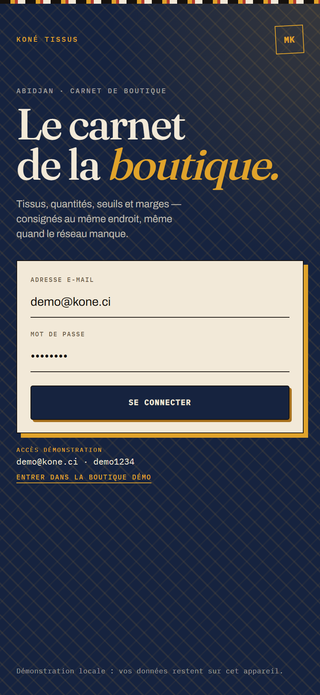 | 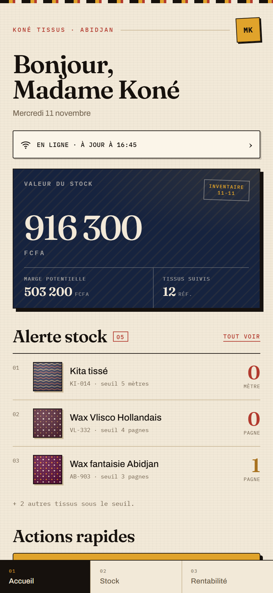 | 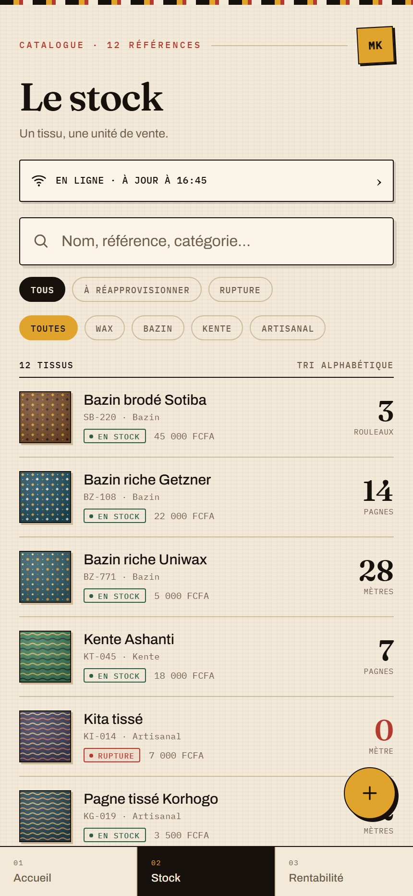 |
| **Connexion** | **Accueil** | **Stock** |
| 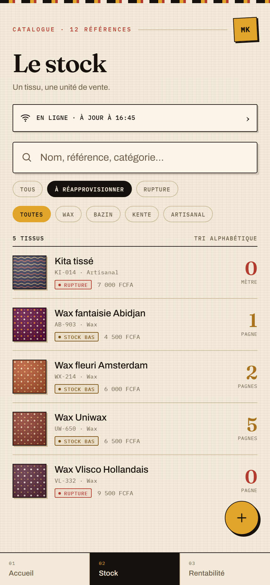 | 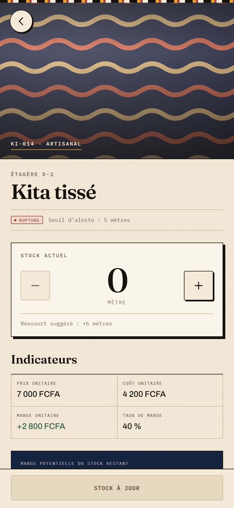 | 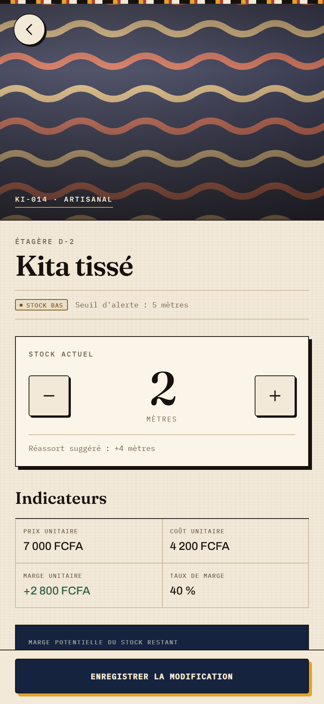 |
| **Stock bas** | **Fiche tissu** | **Ajustement de quantité** |
| 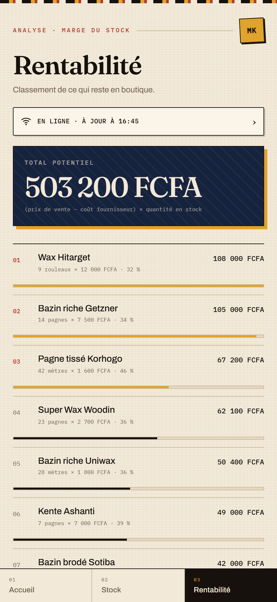 | 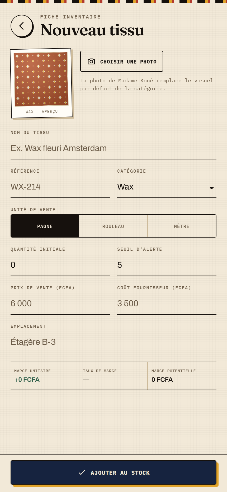 | 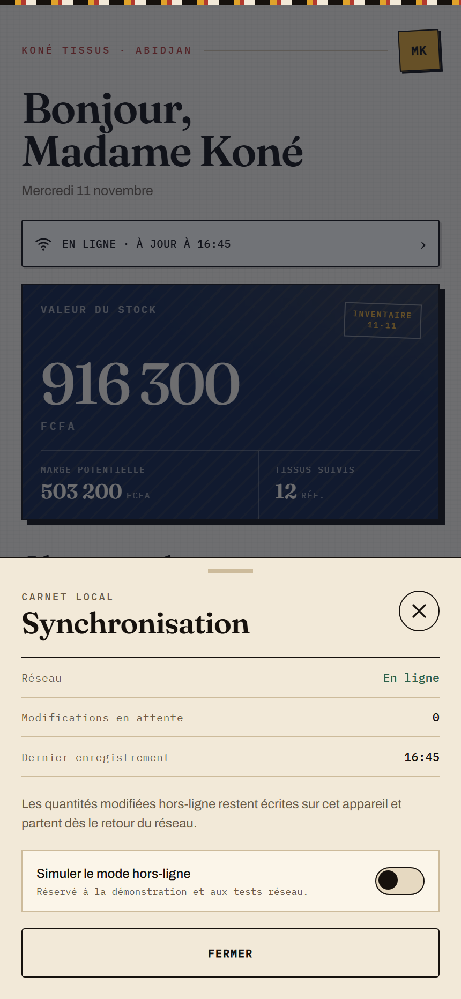 |
| **Rentabilité** | **Nouveau tissu** | **Synchronisation** |
| 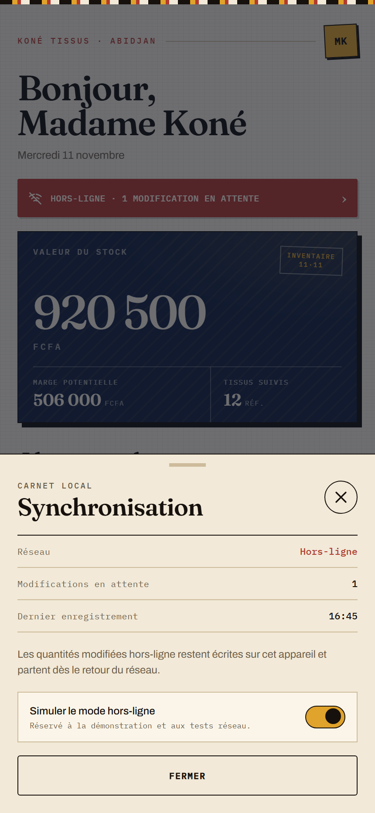 | 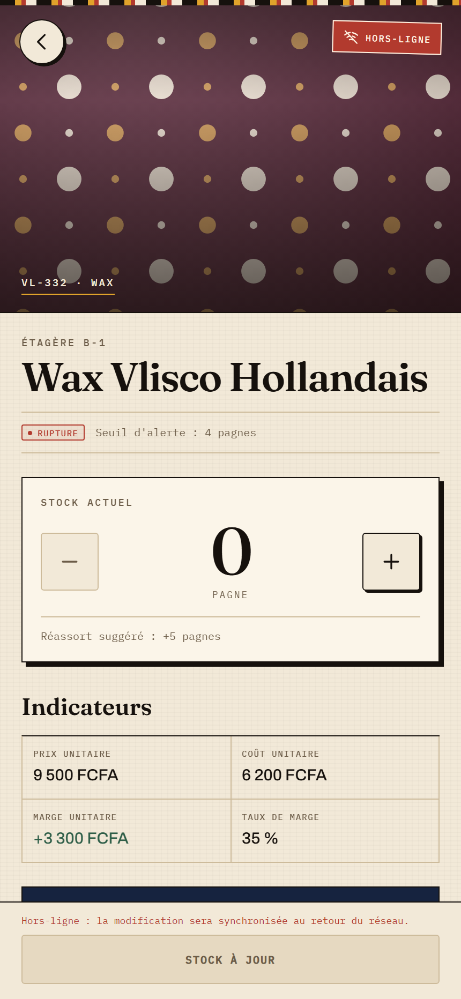 | |
| **File hors-ligne** | **Fiche hors-ligne** | |
